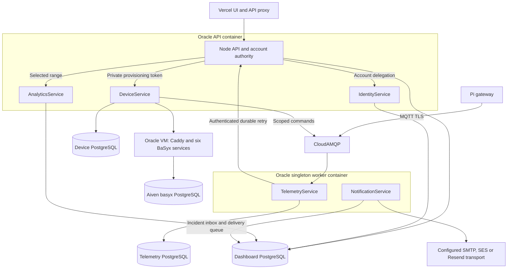

# Backend architecture

Production runs on the existing Oracle ARM64 VM. A separate Caddy/BaSyx Compose stack provides six BaSyx services backed by the dedicated Aiven `basyx` PostgreSQL database. Database/OAuth secrets remain on the VM and outside Terraform state.

The dashboard Node API and five .NET services are packaged in one immutable, non-root ARM64 image. Oracle runs two containers from that image: the API role supervises Node, Device, Identity and Analytics; the singleton worker role supervises Telemetry and Notification. The static React UI is a separate prebuilt Vercel artifact. Caddy exposes only Node HTTPS; private service calls use loopback and scoped credentials. PostgreSQL, Redis and MQTT retain their configured external providers. Physical gateways and firmware remain on the OT network.

Telemetry validates bounded payloads, persists before MQTT acknowledgment, preserves named asset signals and missing values, and retries authenticated dashboard delivery from its PostgreSQL outbox. Stable ingestion IDs and database locks prevent retries from inflating dashboard readings or incidents. Analytics reads the dashboard database directly, so no duplicate AMQP telemetry event is published. Pi command IDs are reserved durably before opening the USB serial port to prevent repeated motion after ambiguous failures. This is an operational control path; it does not replace safety-rated machine interlocks.

Identity uses current dashboard accounts, roles, session versions and revocations. Analytics computes range-bounded SQL coverage and gaps; it does not apply a second conflicting set of example thresholds or invent OEE/RUL. Incident thresholds and downtime confirmation remain in Node. Notification workers consume the PostgreSQL incident/account inbox and authenticated encrypted password-reset queue; provider failures remain bounded and retryable. Lease-aware completion protects newer delivery state from a delayed worker. Email is at least once and provider acceptance is distinct from mailbox delivery.

Production requires verified PostgreSQL TLS, Redis TLS, MQTT TLS and scoped AAS credentials, or the explicitly configured private BaSyx service boundary. Stop the previous worker before starting a replacement using its persistent MQTT identity. The historical environment names `RENDER_SERVICE_ROLE` and `BACKEND_DEPLOYMENT_MODE=render-bundle` remain compatibility identifiers and do not imply Render hosting. Only confirmed operational downtime is displayed as factory downtime. See the canonical [Oracle deployment and release guide](https://github.com/DruHustle/smart-factory-frontend/blob/main/deploy/oracle/README.md) and dashboard [architecture](https://github.com/DruHustle/smart-factory-frontend/blob/main/docs/architecture.md) for cross-repository ownership and topology.

AAS create, revision and import operations compensate confirmed partial writes with a separate 30-second cleanup deadline when the request fails or is cancelled. An ambiguous network outcome or failed compensation still requires repository inspection; this is not a distributed transaction or a guarantee that every upstream write can be recovered.
